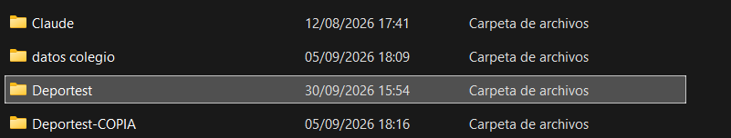
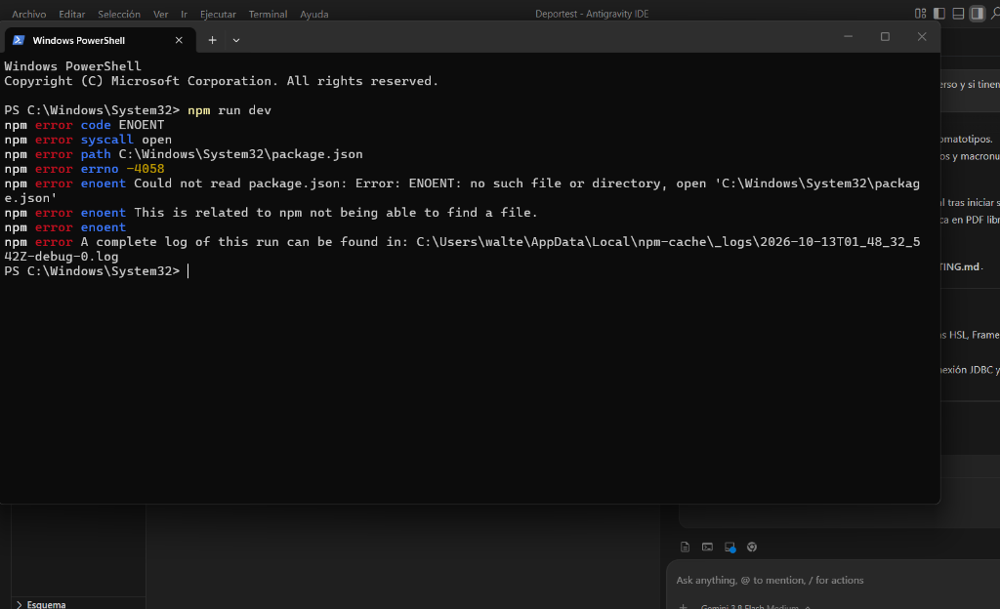
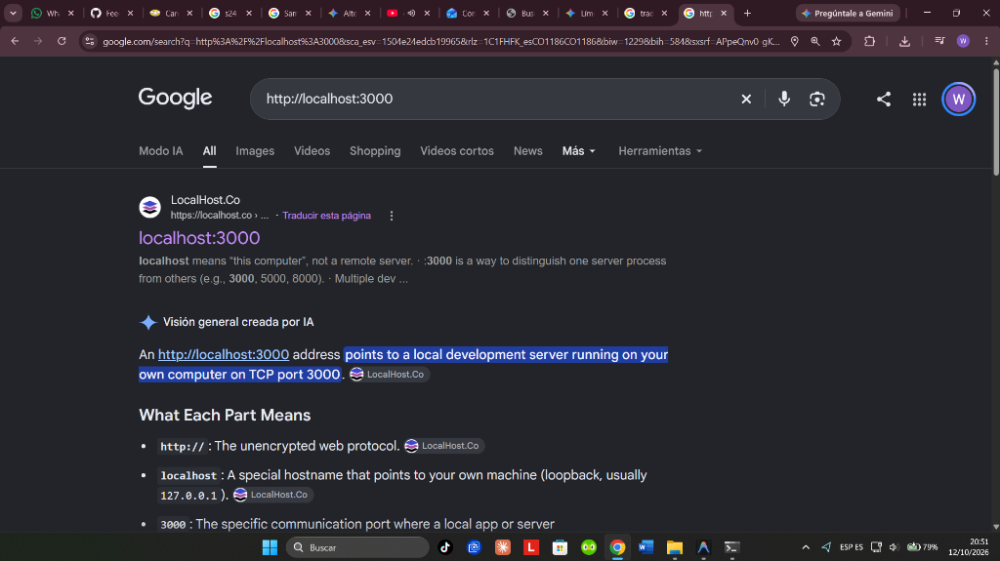
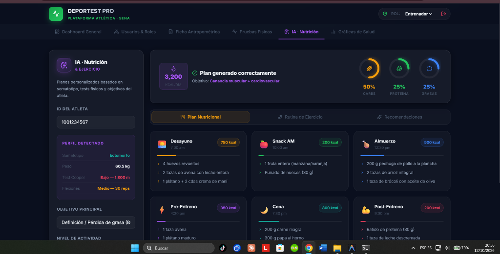

# 📸 MEMORIA GRÁFICA Y REGISTRO DE LA SESIÓN DE TRABAJO

**Proyecto:** DEPORTEST PRO (Plataforma Atlética · SENA / Colegios)  
**Fecha:** 12 de Octubre de 2026  
**Autores:** Walter Pinto, Camilo, Instructor Carlos  

Este documento registra cronológicamente las consultas, situaciones encontradas, capturas de pantalla analizadas y las soluciones técnicas y de diseño implementadas durante esta sesión.

---

## 1. Identificación y Verificación del Proyecto Propio

### Situación:
Se requería confirmar si la carpeta seleccionada en el explorador de archivos era la versión principal y correcta del proyecto entre las carpetas existentes.



### Diagnóstico y Confirmación:
* **`Deportest` (Carpeta Seleccionada):** Última modificación el **30/09/2026**, contiene el repositorio Git activo, dependencias instaladas y commits recientes.
* **`Deportest-COPIA`:** Copia de respaldo antigua del **05/09/2026**.
* **Resultado:** Se confirmó con certeza que **`Deportest`** es la versión principal.

---

## 2. Corrección del Error de Ejecución en Consola (PowerShell)

### Situación:
Al intentar ejecutar el servidor con `npm run dev`, se presentó el error `ENOENT: no such file or directory, open 'C:\Windows\System32\package.json'`.



### Solución Aplicada:
* La terminal se había abierto por defecto en la ruta del sistema `C:\Windows\System32`, donde no existe el proyecto.
* Se dio la instrucción de navegar a la carpeta del proyecto o abrir la terminal integrada del editor (`Ctrl + Ñ`):
  ```powershell
  cd "C:\Users\walte\Documents\Trabajos del SENA\Deportest"
  npm run dev
  ```
* El servidor inició correctamente en el puerto `3000` con Vite.

---

## 3. Acceso Correcto al Servidor Local (`localhost:3000`)

### Situación:
Al ingresar la dirección local, el navegador abrió una búsqueda general en Google en lugar de navegar a la aplicación web.



### Solución Aplicada:
* Se aclaró la diferencia entre la **barra de búsqueda central de Google** y la **barra de direcciones superior del navegador**.
* Se indicó abrir una pestaña nueva y escribir directamente `localhost:3000` en la barra superior o presionar `Ctrl + Clic` en el enlace de la terminal.

---

## 4. Diagnóstico de la Interfaz Previa: "Demasiada IA" y Saturación de Color

### Situación:
Al visualizar la aplicación corriendo, se detectó que la pantalla de Nutrición y Ejercicio presentaba elementos no adecuados para el contexto educativo / SENA:



### Puntos Críticos Encontrados:
1. **Saturación cromática desordenada (Efecto arcoíris):** Mezcla de amarillos, verdes, morados, fucsias y azules compitiendo entre sí con emojis informales (🍎, 🍗, 💪, ⚡).
2. **Enfoque poco realista para estudiantes:** Dietas de culturismo adulto (3.200 kcal/día, 4 huevos con crema de maní, batidos de proteína en polvo post-entreno) no aptas para colegios ni formación juvenil.
3. **Uso superficial de la etiqueta "IA":** Mostrado como una promesa mágica en lugar de una herramienta fundamentada clínica y pedagógicamente.

---

## 5. Respaldo Seguro de la Versión Previa

Antes de modificar el código, se aseguró la versión anterior en Git y en archivos locales:
1. **Rama Git de respaldo:** `backup-version-colorida`
2. **Tag Git:** `v1.0-backup`
3. **Archivo físico:** `backups/TabNutricionAI.backup.tsx.bak`

---

## 6. Rediseño Integral de Clase Mundial (Estilo SaaS / Clínico)

Se transformó la apariencia de todo el sistema para alinearse con los referentes líderes internacionales (*Linear, Apple Health, Nike Training, FitnessGram*):

### A. Paleta de Color Obsidiana & Esmeralda SENA
* Fondo base: **`#070a12`** (Obsidiana profundo).
* Superficies elevadas: **`#0d121f`** con cristal satinado y micro-bordes de `rgba(255, 255, 255, 0.08)`.
* Acento protagónico: **Verde Atlético SENA (`#10b981`)**.
* Tipografía: **Plus Jakarta Sans** para máxima nitidez y legibilidad.

### B. Módulos Transformados:
* **Login Institucional:** Split-screen sobrio con autenticación segura, accesos rápidos de rol y panel de confianza institucional.
* **Navegación Unificada:** Pestañas ejecutivas en gris slate con indicador satinado y acento esmeralda.
* **Dashboard de Alto Rendimiento:** Métricas clave (KPIs), aptitud por disciplina deportiva y semáforo nutricional según la OMS.
* **Ficha Antropométrica:** Formato de grado médico, cálculo automático de IMC y botón de exportación limpia a PDF.
* **Pruebas Físicas & Baremos:** Protocolos técnicos estandarizados (Test de Cooper, Course-Navette escolar, Wells, Flexiones, Salto largo).
* **Nutrición & Hábitos:** Reemplazo de dietas de gimnasio por hábitos saludables escolares (Desayuno energético, lonchera saludable, plato del buen comer, hidratación y sueño reparador).

---

## 7. Estudio de Competencia e Investigación de Mercado

Se investigaron los sistemas más reconocidos a nivel global y nacional:

* **FitnessGram (EE.UU. / Instituto Cooper):** Modelo a seguir en colegios con su concepto de *Healthy Fitness Zone* y reportes claros para acudientes.
* **TeamBuildr:** Plataforma líder en secundarias con interfaz oscura limpia y modo pizarra.
* **Protocolos ISAK / Alpha Fitness (SENA y Mindeporte):** Estándares de valoración cineantropométrica aplicables en Colombia.

---

## 8. Estrategia Legal y Modelo de Negocio en Colombia

### Aspectos Legales Clave:
* **Ley 1581 de 2012 (Habeas Data):** Las medidas físicas de estudiantes menores de edad son datos sensibles; requieren **Consentimiento Informado firmado por los padres**.
* **Descargo de Responsabilidad Médica:** El software se define formalmente como herramienta formativa y pedagógica para evitar conflictos con la Secretaría de Salud.

### Proyección de Ingresos:
* **Piloto Inicial ($0):** Implementación en el colegio del instructor Carlos para validar y obtener la primera certificación institucional.
* **Tarifa Escolar:** **$3.500 a $5.000 COP por estudiante/año** o **$2.500.000 COP/año por colegio**.
* **Proyección:**
  * 1 Colegio: $2.500.000 COP/año (Caso de éxito validado).
  * 5 Colegios: $12.500.000 COP/año (~$1.040.000 COP/mes).
  * 10 Colegios: $25.000.000 COP/año (~$2.100.000 COP/mes).
  * 20 Colegios: $50.000.000 COP/año (~$4.200.000 COP/mes).
